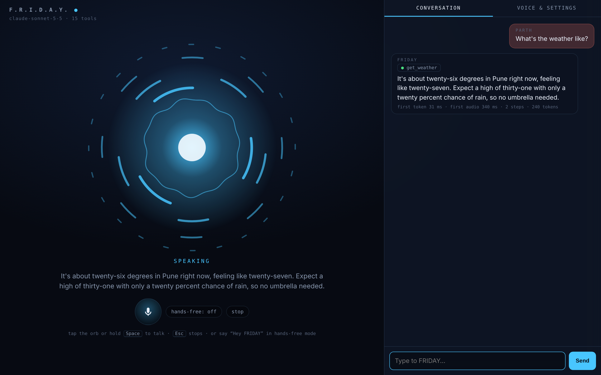
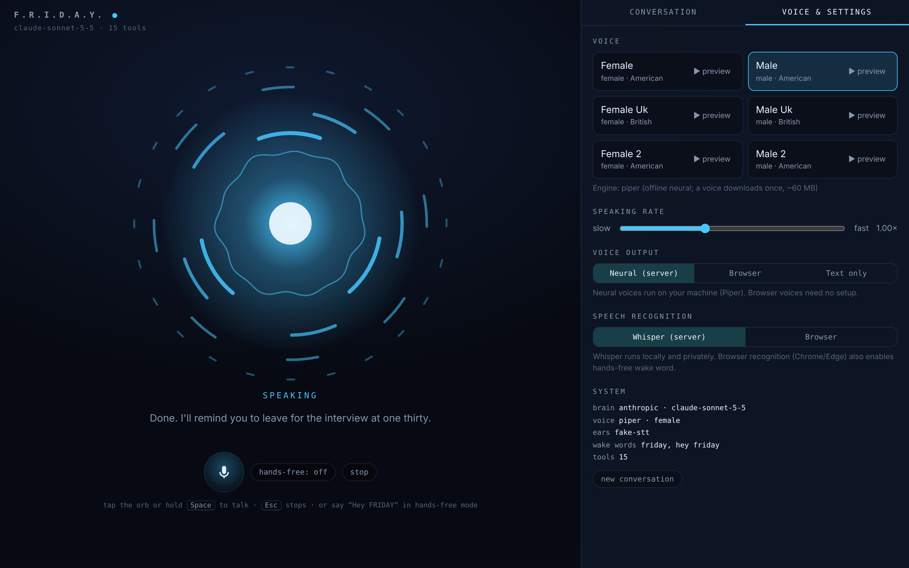
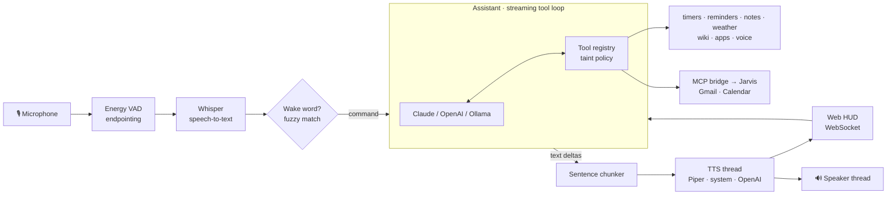

# F.R.I.D.A.Y.

**Fully Responsive Intelligent Digital Assistant for You**: an open-source, voice-first AI assistant in Python. Say *"Hey FRIDAY…"* and she hears you (Whisper), thinks with tools (Claude, OpenAI or a local model), and answers out loud in a **male or female neural voice**. She starts speaking after the first sentence instead of waiting for the whole reply.




---

## What she can do

| | |
|---|---|
| 🎙️ **Hands-free** | Wake word ("Friday", "Hey Friday", even when it's misheard as "Fry day"), then a 6-second follow-up window so the conversation flows without repeating her name. |
| 🗣️ **Male & female voices** | Six offline neural voices (Piper), three male and three female, American and British. Switch any time: *"Friday, use a British male voice and speak a bit faster."* Your OS voices and OpenAI-compatible voices work too. |
| ⚡ **Low latency** | LLM → sentence splitter → TTS → speaker all run **concurrently**, so speech begins after the first sentence. Every answer reports *time to first audio*. |
| 👂 **Private speech recognition** | Whisper runs locally (faster-whisper / CTranslate2) with greedy decoding and silence trimming for short commands. |
| 🧰 **15 tools** | Weather, timers and reminders (announced aloud, and they survive restarts), notes, an exact calculator, Wikipedia, open websites and allow-listed apps, system status, voice control. |
| 📧 **Email & calendar via Jarvis** | Connects to [Jarvis](https://github.com/your-username/jarvis) over **MCP**: *"Friday, anything urgent in my inbox?"* |
| 🛡️ **Safe by design** | **Taint tracking:** once a web page or email enters the turn, FRIDAY can't open apps or links in that turn, so injected instructions can't make her act. The calculator never uses `eval`, and apps must be allow-listed. |
| 🖥️ **Web HUD** | An animated orb that reacts to your voice and hers, push-to-talk (Space), hands-free mode, a live tool timeline, a voice picker with previews, and latency metrics. |

## Quick start

```bash
git clone https://github.com/your-username/friday.git && cd friday
python -m venv .venv && source .venv/bin/activate      # Windows: .venv\Scripts\activate
pip install -e ".[voice]"
cp .env.example .env                                    # add ANTHROPIC_API_KEY
friday download female male                             # one time: 2 voices + Whisper (~300 MB)
```

Then pick how you want to talk to her:

```bash
friday listen          # hands-free on this computer: "Hey FRIDAY, what's the weather?"
friday serve           # web HUD → http://localhost:8765
friday chat --speak    # type, she answers out loud
```

> **No downloads?** Open `friday serve` in Chrome or Edge and choose **Browser** for voice output and speech recognition. The browser's own voices and recognition work immediately.

## Voices

```bash
friday voices                                   # presets and install status
friday --voice male say "Hello, I'm FRIDAY."    # hear one
friday --voice female-uk say "Saved." -o ok.wav # save to a file
friday voices --all                             # Piper's full catalogue (40+ languages)
```

| Preset | Gender | Accent | Piper voice (offline) | OpenAI voice |
|---|---|---|---|---|
| `female` | female | American | `en_US-amy-medium` | nova |
| `male` | male | American | `en_US-ryan-medium` | onyx |
| `female-uk` | female | British | `en_GB-alba-medium` | shimmer |
| `male-uk` | male | British | `en_GB-alan-medium` | fable |
| `female-2` | female | American | `en_US-lessac-medium` | coral |
| `male-2` | male | American | `en_US-joe-medium` | echo |

Set the default with `FRIDAY_VOICE=male` in `.env`, switch by voice (*"use a female voice"*), or click a voice in the HUD (▶ to preview). Any Piper voice id works too, e.g. `FRIDAY_VOICE=en_GB-northern_english_male-medium`. Voices download automatically the first time you choose them.



## Things to say

- *"Hey FRIDAY, what's the weather like?"*
- *"Set a timer for ten minutes for the pasta."* · *"Remind me to call Mom at 9 pm."*
- *"What's 18 percent of 2,450?"* · *"Who was Homi Bhabha?"*
- *"Take a note: parking is on level B2."* · *"Where did I park?"*
- *"Open GitHub."* · *"Open Spotify."* (if allow-listed)
- *"How's my battery?"* · *"Switch to a British male voice and speak faster."*
- With Jarvis: *"Anything I need to reply to today?"* · *"Am I free tomorrow afternoon?"*

## Architecture



```
friday/
├── assistant.py       # streaming tool loop, voice persona, per-turn taint state
├── app.py             # composition root, reminder service
├── voice/
│   ├── pipeline.py    # LLM → sentences → TTS → audio, concurrently; latency metrics
│   ├── tts.py         # Piper / system / OpenAI engines, male & female presets
│   ├── stt.py         # Whisper (local) / OpenAI-compatible
│   ├── audio.py       # microphone, interruptible player, adaptive VAD
│   ├── text.py        # sentence chunker, speech cleanup, wake-word matcher
│   └── loop.py        # hands-free conversation state machine
├── tools/             # registry (schema from type hints + taint policy), built-ins, MCP bridge
├── llm/               # provider-neutral streaming (Anthropic, OpenAI-compatible)
└── server/            # FastAPI + WebSocket protocol + HUD
```

Details and trade-offs: **[docs/ARCHITECTURE.md](docs/ARCHITECTURE.md)** · Interview prep: **[docs/INTERVIEW_GUIDE.md](docs/INTERVIEW_GUIDE.md)**

## Connect Jarvis (email & calendar)

```bash
pip install -e ".[jarvis]"            # MCP client
# in .env:
FRIDAY_JARVIS_MCP_COMMAND=jarvis mcp   # or "jarvis --demo mcp" to try it with sample data
```

FRIDAY starts Jarvis as a subprocess, discovers its tools and exposes them as `jarvis_*`. Anything Jarvis returns is treated as untrusted, and Jarvis still queues outgoing emails for approval in its own dashboard.

## Configuration

Everything is set in `.env` (see `.env.example`): brain (`FRIDAY_PROVIDER`, `FRIDAY_MODEL`), voice (`FRIDAY_TTS_ENGINE`, `FRIDAY_VOICE`, `FRIDAY_SPEAKING_RATE`), ears (`FRIDAY_STT_ENGINE`, `FRIDAY_WHISPER_MODEL`, `FRIDAY_WAKE_WORDS`), apps (`FRIDAY_APPS`), and `FRIDAY_API_TOKEN` for using the HUD from other devices. Run `friday doctor` to check your setup.

**Platform notes:** works on Windows, macOS and Linux. Linux needs `sudo apt install libportaudio2` for the microphone. Use headphones for the smoothest hands-free experience; the mic is muted while FRIDAY speaks, so she never answers herself.

## Development

```bash
pip install -e ".[voice,dev]"
make check            # ruff + mypy + pytest
```

84 tests with no network, models or audio hardware: a scripted LLM, a fake TTS/STT, a fake microphone and speakers, and an in-process MCP server stand in for the real ones.

## A note on the name

FRIDAY is a fan-inspired name for an original project: its own design, voices and personality. It isn't affiliated with, or a recreation of, any film or studio property.

## License

[MIT](LICENSE) © 2026 Parth Tiwari
